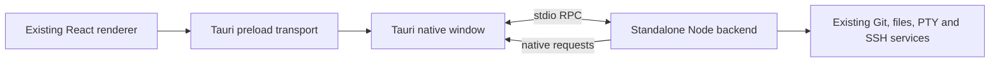

# Tauri desktop migration

Branch: `refactor/tauri-desktop`. This is an experimental migration, not a
replacement for the Electron release yet.

## Run and build

Install the normal pnpm dependencies and a current stable Rust toolchain.
macOS also needs Xcode command line tools; Windows needs MSVC and WebView2.
The bundled official Node runtime sets the macOS minimum to 13.5.

```sh
pnpm dev:tauri
pnpm build:tauri --bundles app --no-sign  # macOS test application
```

`prepare-tauri-desktop.mjs` downloads pinned official Node 24.22.0, verifies
its archive against the official SHA-256 manifest, and stages only native
dependencies for the host platform. It runs a real terminal smoke test against
the staged Node binary before packaging. Builds currently require a native
runner for each target architecture.

The application identifier is `com.wyk15.orcaw.tauri`. Its data directory is
separate from Orcaw's Electron data; it does not migrate the existing profile.
The preparation scripts write generated files only under `out/` and
`src-tauri/binaries/`.

## Architecture



- `src/desktop-host/` hosts existing services under ordinary Node. Its
  Electron compatibility port supplies the trusted window identity, IPC
  registration, paths, and native requests; it does not load Electron.
- `src/renderer/src/tauri/` reuses the existing preload contract and React
  entry. The separate Vite configuration aliases only the preload's Electron
  imports. Browser/mobile pairing and `out/web` are not involved.
- Rust owns the bundled Node process, native file dialogs, default file/link
  opening, trash, and text/image/file clipboard. RPC stays on child-process pipes; no
  HTTP or WebSocket service is opened for desktop communication. Agent status
  hooks use the existing authenticated loopback listener separately.
- The desktop command validates both the window label and origin. Remote
  pages cannot use the backend bridge. stdout belongs to the protocol; Node
  diagnostics go to stderr.
- Closing stages renderer state, awaits persistence, then destroys the
  window. A failed save keeps the window open and permits retry. Referenced
  terminal history is prefetched for the preload's synchronous read API.

## Verified so far

- macOS ARM64: optimized unsigned `.app` builds and renders in WKWebView.
- Actual standalone backend: ordinary folder import, text read/write,
  content search, file authorization, Git status, native terminal input and
  output, and SSH target management.
- Unit coverage includes native request lifetime, binary frames, and save
  failure/retry during window close.
- Persistent terminal daemon: the same shell PID survives backend shutdown
  and a forced backend crash, reattaches, and accepts further input.
- Authenticated loopback agent hook events reach the renderer; packaged plugin
  workers execute commands under ordinary Node and shut down cleanly.
- Clipboard tests cover PNG pixel preservation, image size limits, temp-file
  creation, and rejecting file copies outside authorized workspaces. Image
  paste reuses SSH/runtime upload routing; Linux primary selection stays
  separate from the regular clipboard.
- CI builds unsigned macOS ARM64, Windows x64, and Windows ARM64 applications.

The initial local `.app` is about 162 MiB. This is an unsigned development
comparison, not a published installer measurement or a memory-use guarantee.

## Remaining migration work

- Embedded Chromium browser panes/CDP automation and simulator integration.
- Native notifications, Windows copied-image-file paste fallback, file drag
  and drop, titlebar drag areas, complete menu/shortcut integration, and system
  credential storage.
- CLI installation, plugin panel rendering, managed agent hook installation,
  and complete agent/account startup reconciliation. The hook listener and
  plugin worker execution are connected.
- Persistent terminal recovery in the full UI, Windows installer replacement,
  and complete shutdown/crash coverage.
- Real SSH connection, relay deployment, remote file editing, terminal resume,
  and credential prompts in end-to-end tests. Target CRUD alone does not prove
  remote execution works.
- Windows x64/ARM64 manual WebView2 verification and native clipboard testing.
- Profile import and authentication compatibility with the Electron release.

Unsupported IPC invocations fail explicitly. A short list of disabled
capabilities supplies their existing empty/unavailable status contract.
Automatic updates remain disabled.

## Linux compatibility

Tauri 2 needs WebKitGTK 4.1. Availability on the required Ubuntu 20.04 baseline
has not been established, so Linux Tauri installers are blocked in the launcher.
`pnpm build:tauri --no-bundle` is available for development on a machine with
the required system libraries. Both staged native modules and the final ELF
binary are checked by Orca's existing glibc 2.31 floor verifier. The Electron
Linux release keeps its established compatibility policy.

## Focused tests

```sh
pnpm exec vitest run --config config/vitest.config.ts \
  src/desktop-host/stdio-rpc.test.ts \
  src/shared/desktop-wire-codec.test.ts \
  src/renderer/src/tauri/host-transport.test.ts \
  src/renderer/src/tauri/window-close-barrier.test.ts \
  config/scripts/tauri-backend-smoke.test.mjs
```
