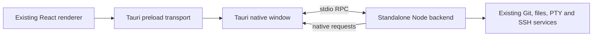

# Tauri desktop migration

Branch: `refactor/tauri-desktop`. This is an experimental migration, not a
replacement for the Electron release yet.

## Run and build

Install the normal pnpm dependencies and a current stable Rust toolchain.
The current migration targets macOS ARM64 only and needs Xcode command line tools.
Windows, Linux, and Intel macOS migration are deferred.
The bundled official Node runtime sets the macOS minimum to 13.5.
Tauri CI is currently manual-only while the migration is in progress.

```sh
pnpm dev:tauri
pnpm build:tauri --bundles app --no-sign  # macOS test application
```

`prepare-tauri-desktop.mjs` downloads pinned official Node 24.22.0, verifies
its archive against the official SHA-256 manifest, and stages only native
dependencies for the host platform. It runs a real terminal smoke test against
the staged Node binary before packaging. Builds currently require a native
macOS ARM64 runner. Other host platforms and Rust targets are rejected before building.

The application identifier is `com.wyk15.orcaw.tauri`. Its data directory is
separate from Orcaw's Electron data; it does not migrate the existing profile.
The preparation scripts write generated files only under `out/` and
`src-tauri/binaries/`.

## Publish a preview

Tauri previews use `vX.Y.Z-wyk.N-tauri.N` tags; `package.json`, the Tauri
configuration and the Rust crate carry the same version. The Electron fork
workflow excludes these tags. Publishing a Tauri preview never marks it Latest.

Push the release commit and tag, then manually run **Tauri Desktop Check**
with `ref` set to that tag and `publish_release` enabled. Ordinary checks remain
unsigned and do not publish. Release builds use the existing Developer ID and
App Store Connect secrets. All bundled Mach-O binaries are signed, including
Node, native dependencies and terminal helpers. Only Node receives the JIT
entitlement. The signed runtime must pass a PTY/native-module smoke test.

Both the application and DMG must pass Apple notarization and stapling before
ZIP, DMG and SHA-256 files reach a draft prerelease. The draft is published only
when all expected assets are uploaded. The workflow validates the exact tag,
commit, app identifier and version; a published release cannot be overwritten.

## Architecture



- `src/desktop-host/` hosts existing services under ordinary Node. Its
  Electron compatibility port supplies the trusted window identity, IPC
  registration, paths, and native requests; it does not load Electron.
- `src/renderer/src/tauri/` reuses the existing preload contract and React
  entry. The separate Vite configuration aliases only the preload's Electron
  imports. Browser/mobile pairing and `out/web` are not involved.
- Rust owns the bundled Node process, native file dialogs, file opening,
  trash, text/image/file clipboard and macOS notifications. HTTP(S) links open
  in Google Chrome, falling back to the system browser if Chrome is unavailable.
  RPC stays on child-process pipes; no
  HTTP or WebSocket service is opened for desktop communication. Agent status
  hooks use the existing authenticated loopback listener separately.
- The desktop command validates both the window label and origin. Remote
  pages cannot use the backend bridge. stdout belongs to the protocol; Node
  diagnostics go to stderr.
- Closing stages renderer state, awaits persistence, then destroys the
  window. A failed save keeps the window open and permits retry. Referenced
  terminal history is prefetched for the preload's synchronous read API.
- Credentials use a random AES-256-GCM key kept in the system credential
  store (Keychain, Windows Credential Manager, or Linux Secret Service).
  Initialization must unlock that key before opening the profile. A public
  fingerprint detects missing/replaced keys; the app refuses to overwrite
  existing credentials when the key does not match. This format does not
  decrypt the Electron profile's ciphertext.
- The existing translated application menu runs through native Tauri menus.
  Menu actions use the same renderer events, keybinding overrides, and settings.
  Closing and reloading share one save barrier. Native focus/maximize/fullscreen
  state feeds the existing backend window identity.

## Verified so far

- macOS ARM64: optimized unsigned `.app` builds, starts and quits normally.
  The current local build is about 162 MiB.
- Notification bridge tests cover authorization state, denied permissions,
  delivery failure, focus suppression, cooldown, sounds, click routing for folder
  panes, and dismissal while submission is pending. Browser policy tests cover
  saved preferences, modifiers, legacy tab creation and capability/RPC removal.
- Actual standalone backend: ordinary folder import, text read/write,
  content search, file authorization, Git status, native terminal input and
  output, and SSH target management.
- Unit coverage includes native request lifetime, binary frames, and save
  failure/retry during window close.
- Persistent terminal daemon: the same shell PID survives backend shutdown
  and a forced backend crash, reattaches, and accepts further input.
- Authenticated loopback agent hook events reach the renderer; packaged plugin
  workers execute commands under ordinary Node and shut down cleanly.
- Clipboard tests cover PNG pixel preservation, image size limits, temp-file
  creation, and rejecting file copies outside authorized workspaces. Image
  paste reuses SSH/runtime upload routing; Linux primary selection stays
  separate from the regular clipboard.
- Earlier CI builds produced macOS ARM64 and Windows applications. The current
  manual workflow only builds macOS ARM64; no new Actions run is started.
- macOS native startup unlocks Keychain, creates the native menu, and renders
  with the existing titlebar layout. A second launch focuses the original
  window; quitting and reopening succeeds with the same stored key.
- Credential storage tests verify ciphertext on disk and decryption after
  restart. Menu, titlebar, paste ownership and native drop routing have focused
  coverage. macOS/Linux system drops route by the existing editor, terminal,
  composer, explorer and project-sidebar markers; gesture testing remains.

The initial local `.app` is about 162 MiB. This is an unsigned development
comparison, not a published installer measurement or a memory-use guarantee.

## Product scope

Embedded browser panes and CDP automation are excluded from this build:
browser creation/setup/settings/shortcut entries are hidden, saved browser
preferences cannot reactivate them, and runtime browser methods and capabilities
are disabled. Markdown preview remains available.

## Remaining migration work

- Simulator integration.
- Signed macOS notification verification (permission prompt, banner and click),
  system resume, and complete menu/shortcut parity. The bridge reuses existing
  notification settings, focus suppression, cooldown, custom sounds and pane
  navigation. Permission is read from UserNotifications; accepted scheduling
  does not guarantee a banner under Focus or other OS policies. Unbundled dev
  binaries cannot use native notifications.
- CLI installation, plugin panel rendering, managed agent hook installation,
  and complete agent/account startup reconciliation. The hook listener and
  plugin worker execution are connected.
- Persistent terminal recovery in the full UI and complete shutdown/crash coverage.
- Real SSH connection, relay deployment, remote file editing, terminal resume,
  and credential prompts in end-to-end tests. Target CRUD alone does not prove
  remote execution works.
- Profile import and authentication compatibility with the Electron release.

Unsupported IPC invocations fail explicitly. A short list of disabled
capabilities supplies their existing empty/unavailable status contract.
Automatic updates remain disabled.

## Deferred platforms

Tauri builds are limited to macOS ARM64 during this migration. The existing
Electron platform support and SSH relay targets remain intact. Before bringing
Linux Tauri back, establish WebKitGTK 4.1 availability on Ubuntu 20.04 and restore
the final executable glibc 2.31 verification. Windows needs separate WebView2,
installer, file drop and clipboard verification.

## Focused tests

```sh
pnpm exec vitest run --config config/vitest.config.ts \
  src/desktop-host/stdio-rpc.test.ts \
  src/shared/desktop-wire-codec.test.ts \
  src/renderer/src/tauri/host-transport.test.ts \
  src/renderer/src/tauri/window-close-barrier.test.ts \
  config/scripts/tauri-backend-smoke.test.mjs
```
